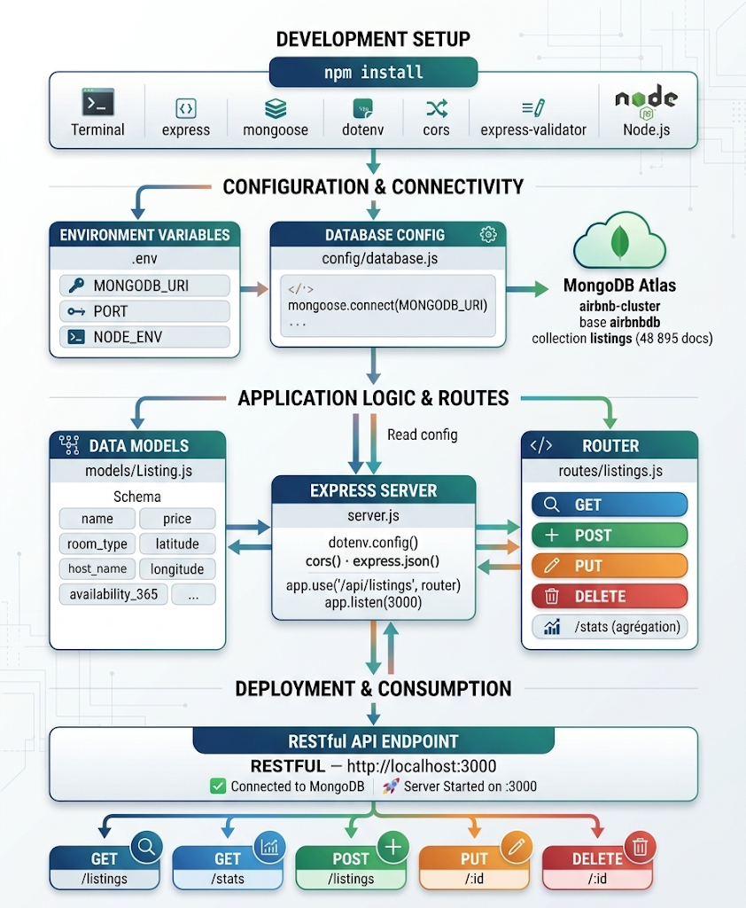

# Airbnb NYC API : API RESTful avec Node.js et MongoDB Atlas

API RESTful complète (CRUD, filtres, pagination, agrégations) construite sur le jeu de données **New York City Airbnb Open Data** (48 895 logements, 2019) et connectée à une base **MongoDB Atlas** hébergée dans le cloud.

Projet du module Bases de Données NoSQL, INGC2 InDIA 2025 à 2026, ESMT Dakar.

## Fonctionnalités

- 6 routes REST : liste paginée avec filtres, statistiques agrégées, lecture, création, modification partielle et suppression.
- Schéma Mongoose avec validations (`required`, `enum`, `min`, `max`) et index de performance (`price`, `neighbourhood_group + price`, `room_type`, `neighbourhood`).
- 10 requêtes MongoDB d'interrogation, dont 5 pipelines d'agrégation (`$group`, `$match`, `$sort`, `$project`, `$round`, `$divide`).
- Configuration sécurisée par variables d'environnement (`.env`, non versionné).
- Tests de tous les endpoints avec Postman (voir le rapport).

## Technologies

Node.js, Express 5, Mongoose 9, MongoDB Atlas (cluster gratuit M0 sur AWS), MongoDB Compass, dotenv, cors, Postman.

## Architecture



## Structure

```
airbnb-api/
├── server.js               Point d'entrée : Express, middlewares, routes
├── config/database.js      Connexion à MongoDB Atlas via Mongoose
├── models/Listing.js       Schéma Mongoose et index
├── routes/listings.js      Les 6 routes REST
├── scripts/
│   ├── queries.js          10 requêtes MongoDB documentées
│   └── AB_NYC_2019.csv     Jeu de données (48 895 lignes)
└── docs/
    ├── architecture.png                            Schéma d'architecture
    └── Rapport_API_Airbnb_NYC_MongoDB_Atlas.docx   Rapport complet du projet
```

## Installation

```bash
git clone https://github.com/cheickbougoum90-web/airbnb-api.git
cd airbnb-api
npm install
cp .env.example .env     # puis renseigner MONGODB_URI
```

1. Créez un cluster gratuit sur [MongoDB Atlas](https://www.mongodb.com/cloud/atlas/register), un utilisateur de base de données et autorisez votre adresse IP.
2. Avec MongoDB Compass, créez la base `airbnbdb` et la collection `listings`, puis importez `scripts/AB_NYC_2019.csv`.
3. Renseignez votre chaîne de connexion dans `.env`.

```bash
npm start                # API sur http://localhost:3000
npm run queries          # exécute les 10 requêtes d'analyse
```

## Documentation de l'API

URL de base : `http://localhost:3000`. Format : JSON. Authentification : aucune (projet académique).

| Méthode | Route | Description |
| --- | --- | --- |
| GET | `/api/listings` | Liste paginée (20 par page). Filtres : `neighbourhood`, `room_type`, `min_price`, `max_price`, `page` |
| GET | `/api/listings/stats` | Nombre de logements, prix moyen, min et max par arrondissement |
| GET | `/api/listings/:id` | Détail d'un logement par `_id` MongoDB |
| POST | `/api/listings` | Créer un logement |
| PUT | `/api/listings/:id` | Modifier partiellement un logement (`$set`) |
| DELETE | `/api/listings/:id` | Supprimer un logement |

Codes de réponse : `200` succès, `201` création, `400` données invalides (validation Mongoose), `404` logement introuvable, `500` erreur serveur.

Exemple de requête :

```
GET /api/listings?neighbourhood=Brooklyn&max_price=80&page=1
```

Exemple de création :

```json
POST /api/listings
{
  "name": "Studio moderne",
  "host_name": "Jean",
  "neighbourhood_group": "Brooklyn",
  "room_type": "Private room",
  "latitude": 40.7128,
  "longitude": -74.0060,
  "price": 75
}
```

## Rapport

Le rapport complet (choix du dataset, requêtes, déploiement Atlas, explication du code, documentation de l'API et captures des tests Postman) se trouve dans `docs/Rapport_API_Airbnb_NYC_MongoDB_Atlas.docx`.

## Pistes d'amélioration

- Sécuriser les routes d'écriture avec une authentification JWT.
- Ajouter des requêtes géospatiales à partir des coordonnées GPS.
- Valider les entrées avec `express-validator` (déjà installé) et échapper le paramètre `neighbourhood`, utilisé dans une expression régulière.
- Déployer l'API sur une plateforme cloud publique (Render, par exemple).

## Auteur

**Cheïck Abdoul Aziz BOUGOUM**, élève ingénieur Données et IA, ESMT Dakar
[LinkedIn](https://www.linkedin.com/in/che%C3%AFck-abdoul-aziz-bougoum-7264243aa) · [GitHub](https://github.com/cheickbougoum90-web)
